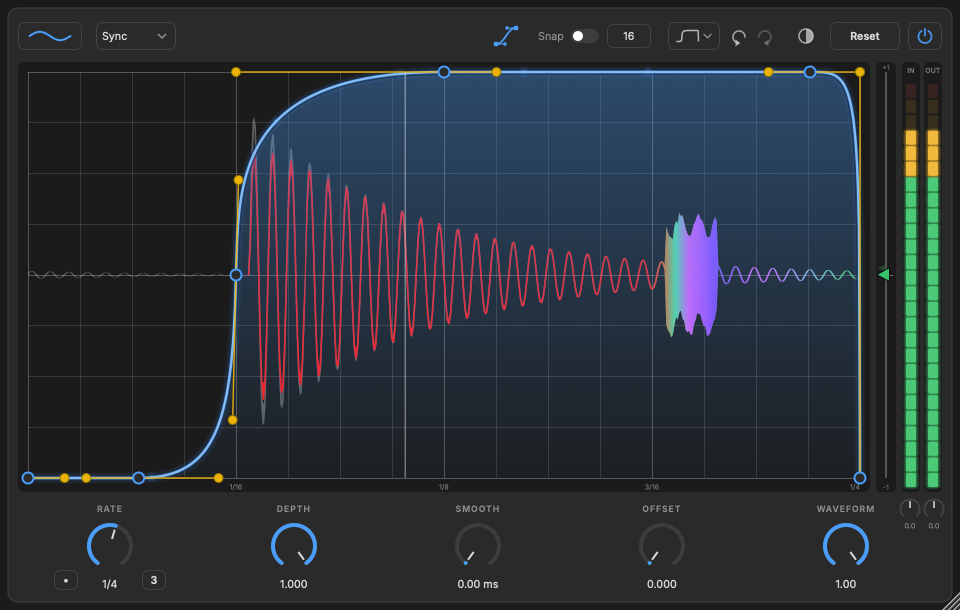
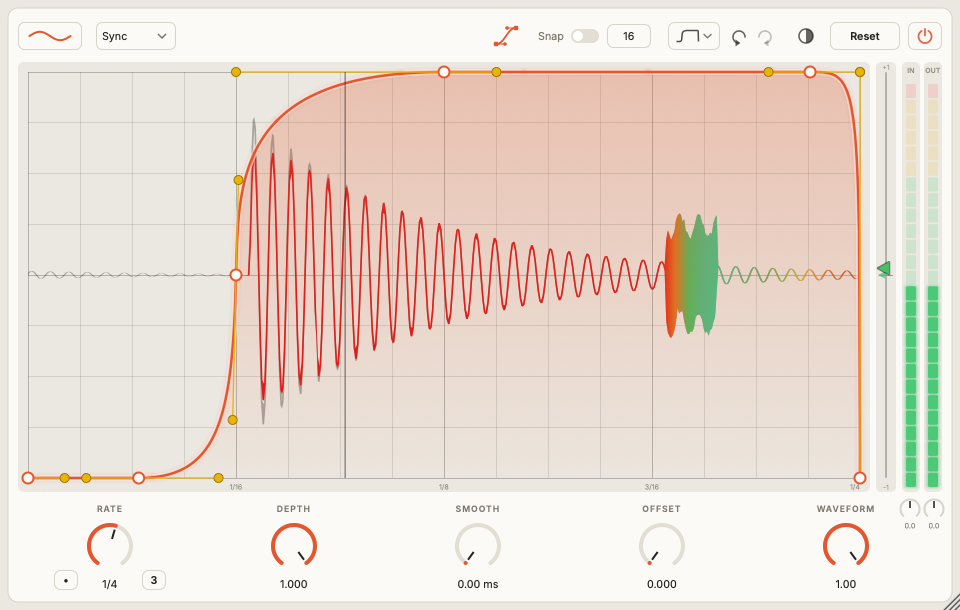

# MUVMNT LFO

A free VST3 volume shaper for sidechain-style pumping, gating, tremolo and rhythmic volume patterns. Draw a curve and the plugin ducks your sound along it, locked to your DAW's tempo. **Multiband mode** gives the lows, mids and highs their own curves.

**[Download the beta](https://github.com/baggofficial/MUVMNT-LFO/releases)** for Windows or macOS · Made by [**BAGG**](#about-bagg)




<details>
<summary><b>More screenshots</b></summary>




</details>

## Features

- **Curve editor** with After Effects-style bezier handles, or a Simple mode with one draggable diamond per segment. Up to 64 points, grid snapping and undo / redo.
- **Presets:** 19 factory shapes, 8 all-band Multiband presets, your own saved presets, and copy / paste between plugin instances.
- **Timing:** synced to the song from 8 bars to 1/64 (with dotted and triplet), or free-running from 0.01 to 40 Hz with optional MIDI retrigger. Plus Depth, Smooth and Offset.
- **Multiband:** 2 or 3 bands, each with its own curve, rate, depth, smoothing, offset, volume and solo. Choose **Crossover** (6 to 96 dB/octave) or **Dynamic EQ** (zero latency), with a live spectrum behind the splits.
- **Auto Curve:** turns your sidechain kick into an editable curve.
- **Visual feedback:** input and output waveforms on the curve, the sidechain kick with clashes hatched, a click-risk meter and IN / OUT peak meters.
- **Extras:** input / output gain, polarity reverse, a Multiband output clipper, click-free bypass, light and dark themes, and a resizable window.

## Install

**Windows (VST3, 64-bit)**
1. From [**Releases**](https://github.com/baggofficial/MUVMNT-LFO/releases), download the newest file ending in `windows-vst3.zip` and unzip it.
2. Copy the `MUVMNT LFO.vst3` folder to `C:\Program Files\Common Files\VST3\`.
3. Rescan plugins in your DAW.

**macOS (VST3, macOS 11 or newer, Apple Silicon and Intel)**

The Mac version passes the automated tests but **has not been tried in a DAW yet**.
1. From [**Releases**](https://github.com/baggofficial/MUVMNT-LFO/releases), download the newest file ending in `macos-vst3.zip` and unzip it.
2. Copy `MUVMNT LFO.vst3` to `~/Library/Audio/Plug-Ins/VST3/` (in Finder: **Go > Go to Folder**).
3. Apple has not notarised the build, so macOS is likely to block it. If you trust the download, remove the block in Terminal:
   ```bash
   xattr -dr com.apple.quarantine "$HOME/Library/Audio/Plug-Ins/VST3/MUVMNT LFO.vst3"
   ```
4. Rescan plugins in your DAW.

Logic Pro and GarageBand can't load it, because they need Audio Units. AU, AAX and CLAP are not available yet.

## Using it

Double-click to add a point and drag to shape the curve. Open a section below for more.

<details>
<summary><b>All controls</b></summary>

| Do this | To get this |
|---|---|
| Double-click empty space | Add a point |
| Drag a point | Move it (the first and last points share one height, so the loop doesn't click) |
| Double-click a point | Delete it (the first and last points stay) |
| Double-click the first or last point | Toggle easy-ease (flat tangents) |
| Drag a handle | Bend the curve; the opposite handle follows on smooth points |
| Shift while dragging a handle | Break the handles apart |
| Option/Alt or Ctrl while dragging a handle | Snap the handle's tip to the grid |
| Hold Option/Alt while dragging or adding a point | Snap to the grid (reversed if the **Snap** switch is on) |
| Drag the number next to **Snap** | Set the number of grid lines (2 to 64) |
| Click empty space / click the curve | Hide / show all points and handles |
| **Bezier handles** switch | Switch between handles and Simple mode (the curve is converted) |
| Drag a diamond (Simple mode) | Bend that segment; double-click to straighten |
| Ctrl/Cmd+Z, Shift+Ctrl/Cmd+Z or Ctrl+Y, or the top-bar arrows | Undo / redo curve edits (last 50 steps) |
| **Presets** | Pick or save a curve, copy or paste |
| **Reset Curve** | Restore the current curve to its default |
| Double-click or right-click a knob | Type an exact value (rates accept `1/8`, `8`, `1 bar`...). Right-click also has Reset and your DAW's options, such as automation, if it provides them |
| Ctrl/Cmd-click or Alt-click a knob | Reset it |
| **Note / Hz** switch (left of Rate) | Rate synced to the song, or in Hz. In Full Band, Hz mode adds a **MIDI retrigger** switch |
| **•** / **3** (right of Rate, in Sync) | Dotted / triplet |
| **Simple** / **Detailed** under Auto Curve | Make a curve from the sidechain kick |
| **Full Band / Multiband** | One curve for the whole sound, or one per band |
| Click the end-of-cycle meter | Show or hide the end-zone bar |
| Small knobs under the meters | Input / output gain; double-click, Ctrl/Cmd-click or Alt-click resets to 0 dB, right-click for options |
| **Ø IN** | Reverse the input's polarity (filled while on) |
| **Clipper** (Multiband) | Cycle the output clipper: Off / Soft / Hard |
| Power button | Bypass (the same switch as your DAW's bypass) |
| Half-moon button | Light / dark theme |
| **60 / 30 fps** | Window animation speed; 30 uses less CPU. The sound is not affected |
| Drag the bottom-right corner | Resize the window (880x500 to 2000x1300) |

The theme, frame rate and window size are remembered.

</details>

<details>
<summary><b>Auto Curve</b></summary>

1. Route your kick into the plugin's sidechain.
2. Set **Rate** so one cycle holds one hit (usually 1/4 for a kick on every beat).
3. While the project plays, press **Simple** or **Detailed**.

It reads the audio once, when you press: the last full cycle of the kick and, for Detailed, your sound's loudness over the last four cycles. It doesn't keep following the audio. It changes only the curve (in Multiband, only the selected band), and one undo brings the old one back. Treat the result as a starting point and adjust it by ear.

| | Simple | Detailed |
|---|---|---|
| Looks at | the kick only | the kick **and** your sound |
| Curve | 3 to 6 points: down while the kick is strong, then one smooth rise | up to 16 points: follows how much room is left, including dips where both are loud again |
| Gives you | a predictable duck with plenty of room for the kick | more of your sound, mostly when it is plucked, rhythmic or fading in. With a steady, loud sound the two keep about the same amount |
| Watch out for | ducking more than needed | it's fitted to the last four cycles, so press it again where the notes or rhythm change. It's also more detailed to edit by hand |

- **Levels:** both duck fully at the kick's loudest moment (at Depth 1.000). Detailed measures the kick and your sound each against its own peak, so send levels don't matter; it assumes the two are about equally loud in your mix. If your sound is silent, it assumes full level. It compares peaks, not frequencies or perceived loudness, so it can't guarantee against clipping or masking.
- **The end of the cycle:** both end with a short drop just before the loop point. If the kick is still ringing there, Detailed stays at the room it leaves instead of jumping to full first. If a sharp kick on the beat seems to start a few milliseconds early, Simple stays silent up to the loop point, while Detailed ends its drop right at it.
- **Other settings:** Depth, Smooth, Offset and Rate stay as they are. Lower Depth for gentler ducking, and remember that Smooth delays the shape.
- **Long kicks and several hits (Detailed only):** it can handle kicks still ringing when the next one comes (many hard-techno kicks and 808s at fast tempos) and up to four hits per cycle. A kick that stays loud leaves little room, so your sound stays well down and rises late. With a kick on every beat, a 1/4 rate is still the most accurate.
- **When it refuses:** it says why and changes nothing. Reasons include no sidechain, silence, less than a full cycle recorded since the window opened or the rate or offset changed, a hit still ringing at the loop point, too little kick in the selected band, or a signal that never fades enough or has more than one hit per cycle. Detailed accepts some of the last two (see above), but still refuses a kick that never dies down, a steady bass line, more than four hits, or hits too close together to follow with 16 points.

</details>

<details>
<summary><b>Multiband</b></summary>

- **Select and split:** click a coloured region to edit that band. Move a split by dragging its line, slope box or frequency. With two bands the split goes up to 12 kHz; with three, the low split stops at 1 kHz.
- **Slopes (Crossover only):** click a slope box to choose 6, 12, 24, 48, 72 or 96 dB/octave for each split.
- **Spectrum:** the grey fill is the input; the blue line is the output after ducking. The strip also shows each band's filter response.
- **Band volume:** drag a band's line up or down (-12 to +6 dB, Shift for fine control; double-click, Ctrl/Cmd-click or Alt-click resets it). It sets the balance without changing the curves. Presets and Reset Curve leave it alone, and your DAW can automate it.
- **Solo:** press **S** beside a band's name. Several bands can be soloed.
- **Linking:** the chain beside Rate, Depth, Smooth or Offset makes every band use one value, copied from the one you're viewing. Your DAW then lists it as "All Bands ..."; it is the Mid parameter (Low with two bands), so automate it with the link on.
- **All-band presets:** one click sets every band's curve and the band count (a 2-band preset leaves the mid curve alone). Rates, depths and splits stay put.
- **Defaults:** a house-style pump where the lows stay ducked longest and the highs recover fastest.

</details>

<details>
<summary><b>Waveforms, meters and gain</b></summary>

- **Waveforms:** the input is drawn faintly, folded onto the LFO cycle, with the plugin's output over it. In Full Band the output is coloured by pitch (a rough estimate: red lows through to blue highs); in Multiband, by band. **Audio view** sets how strong they are. A grey line shows the actual gain after Depth, Smooth and Offset.
- **Sidechain and overlap:** the sidechain is drawn in gold and never changes the sound by itself. Where the kick and the ducked output are both loud, the stretch is **hatched**. It compares each signal's loudness over time, against its own peak. In Multiband each band is compared with the matching part of the kick.
- **End-of-cycle meter:** shows where the output waveform is when the curve drops; the large arrow is the newest cycle. Near the centre is safe. Yellow, orange or red means the wave is still swinging, which can click: duck harder at the end, ease the fall or add some Smooth. Click it for an **end-zone bar** showing the range over the last 4% of the cycle. In Multiband it follows the selected band.
- **IN / OUT meters:** peak meters up to 0 dB in Full Band and +6 dB in Multiband, where adding bands and boosting them can go over. The red lamp lights for two seconds on any peak above 0 dBFS.
- **Gain knobs:** -24 to +24 dB. Input gain comes before everything else; output gain comes before the clipper.
- **Ø IN:** flips the input's polarity, not the sidechain's. You'll only hear it where the sound plays with another one, such as a bass under a kick. It adds no delay and switches without clicks.
- **Clipper:** Soft (linear up to -2 dB, then a smooth shoulder) or Hard (flat at 0 dB). It's off by default.

</details>

## Which mode should I use?

Use **Full Band** unless you need different ducking for the lows, mids and highs.

| You want | Try |
|---|---|
| Classic sidechain pumping on one sound | Full Band |
| Hard, clean ducking of only the lows | Multiband, Crossover |
| Gentle movement on a full mix, keeping drums close to the original | Multiband, Dynamic EQ |
| Blending with a dry copy outside the plugin | Full Band |

<details>
<summary><b>The trade-offs in detail</b></summary>

### Full Band

It's only a volume knob that follows your curve: no filters, latency or phase shift. As with any volume shaper (and with each band in Multiband):

- **Clicks:** a very fast drop or rise can click, especially on bass and 808s. Ease the edge or add some Smooth.
- **Too much Smooth** rounds off the shape and delays it, so the pump feels less tight.
- **Very fast, deep movement** (fast Hz rates, hard gates) changes the tone as well as the volume.
- **It ducks everything together**, so hats and vocals in the same audio dip with the bass.

### Multiband: Crossover (default)

**Good for:** the clearest separation, such as ducking the lows hard while barely touching the highs.

- **Phase shifts even with flat curves** near the splits (except at 6 dB). No latency is reported, because the shift differs by frequency and your DAW can't compensate for it.
- **Drums can feel a bit softer**, often subtly. Compare with bypass, which skips the filters (Depth 0 doesn't).
- **Peaks can get higher** even with nothing ducked: about 4 to 6.5 dB in a test with a clipped 55 Hz bass (no rise at 6 dB). Watch the OUT meter, lower OUT, or use the Clipper, which adds distortion when it works.
- **Parallel blending can cancel frequencies** (every slope except 6 dB), including a dry duplicate or an outside wet/dry mix. Use Depth instead if you want less effect.
- **Steeper slopes** separate better but shift more and use more CPU. Around a 150 Hz split the delay is roughly 3 ms at 24 dB, up to about 8 ms at 48 dB and 19 ms at 96 dB; at 2.5 kHz and 24 dB it's about 0.2 ms. **24 dB is a good starting point.** The 6 dB bands overlap a lot.

### Multiband: Dynamic EQ

**Good for:** staying close to the original, especially on full mixes and drums. It works like an EQ that moves with your curves.

- **Flat curves leave the audio untouched**, bit for bit (band volumes and gain knobs at 0 dB, Clipper and Ø IN off), with no added latency.
- **It still shifts phase when the bands are at different levels**, like any EQ.
- **The bands are less separate:** the slope is fixed and gentle (about 12 dB/octave).
- **It ducks less deeply.** With a 200 Hz split and the low band fully ducked, 60 Hz drops about 21 dB (42 dB in Crossover at 24 dB) and 100 Hz about 12 dB (25 dB). For nearly no low end, use Crossover or raise the split, which affects more of the sound above it.
- **Keep three-band splits far apart**, or the mid band gets weaker and less focused.

### Band volumes

They work in both types, after the ducking. In Dynamic EQ they reach further into neighbouring bands, and unequal volumes shift phase even with flat curves. Boosting raises your peaks, so watch the OUT meter.

Trust your ears: match the volume and compare with bypass while the whole track plays.

</details>

## Performance

Audio processing is light: on an Apple Silicon Mac at 48 kHz, Full Band uses about **0.03% of one CPU core**, and the heaviest Multiband setting about **0.5%**. **The open window costs much more**, so close it or switch to 30 fps if you need CPU.

<details>
<summary><b>Measurements</b></summary>

**Audio processing**, as a share of one CPU core, from the offline test suite on an Apple Silicon Mac (stereo, Release build, 512-sample blocks). It excludes drawing the window. "Editor open" means only the extra audio analysis that feeds the displays.

| Mode | 44.1 kHz | 48 kHz | 96 kHz | 192 kHz |
|---|---|---|---|---|
| Full Band, editor closed | 0.03% | 0.03% | 0.06% | 0.12% |
| Full Band, editor open | 0.07% | 0.07% | 0.15% | 0.31% |
| Multiband 24 dB/oct, editor closed | 0.17% | 0.18% | 0.37% | 0.74% |
| Multiband 96 dB/oct (heaviest), editor closed | 0.46% | 0.51% | 1.01% | 2.01% |
| Multiband 96 dB/oct, editor open | 0.54% | 0.59% | 1.15% | 2.27% |
| Multiband Dynamic EQ, editor closed | 0.09% | 0.09% | 0.19% | 0.38% |
| Multiband Dynamic EQ, editor open | 0.16% | 0.17% | 0.33% | 0.63% |
| Bypassed | ~0% | ~0% | ~0% | ~0% |

32-sample blocks cost more, up to about 45% extra in the lightest modes. These figures come from one machine and will differ on yours.

**The open window:** on an Apple M1 Pro with audio running, a test program showing it at the default size used about **24% of one core in Full Band** and **30% in 3-band Multiband** at 60 fps, or about 15 to 16% and 24% at 30 fps (whole process, audio included; two runs each, with other programs running). Closing the window removes this cost. It has **not been measured on Windows**, which draws differently.

**Size:** on macOS the VST3 is about 5 MB built for Apple Silicon only. The download holds both Apple Silicon and Intel versions and is about 10 MB unzipped.

</details>

## Known limitations

- **Tested by hand mainly in FL Studio on Windows.** Other DAWs (Ableton, Logic, Reaper, Bitwig) and other operating systems have not been tried by hand.
- **The sidechain doesn't trigger the LFO.** It is only shown and read by Auto Curve. The LFO follows the host tempo, or MIDI in Hz mode.
- **Auto Curve only knows recent audio** (one cycle of the kick, four of your sound for Detailed), and Simple only handles one fading hit per cycle.
- **The overlap hatching is a guide.** It doesn't compare frequencies in Full Band or how loud the two are in your mix, and it gets patchier with low notes at very short cycles.
- **Structural switches dip the audio** for about 8 ms: tab, Multiband type, band count and slopes.
- **Bypass stops the LFO.** In Hz mode its phase pauses; in Sync it stays on the beat.
- **Not built yet:** a full preset browser (folders, rename), copying whole Multiband setups, audio or envelope triggering, and AU, AAX or CLAP.

## For developers

<details>
<summary><b>Design rules the tests check</b></summary>

- **The LFO can only turn things down.** Its gain is `1 - depth x (1 - curve)`, always between 0 and 1. Only the gain knobs and band volumes can add level.
- **100% is a perfect null.** In Full Band, with the curve at 100% or Depth at 0 (gain knobs at 0 dB, Ø IN off), the output matches the input bit for bit, including after settings change and settle.
- **0% is silence**, not a faint residue.
- **No clicks.** Jumps in the LFO value (new rate, mode, offset or depth, a transport jump or MIDI restart) glide over a few milliseconds, even with Smooth at 0. Solo and band changes fade, split moves glide, and structural switches dip for about 8 ms.
- **Block size doesn't change the result:** 8192-sample and 1-sample blocks give the same audio.
- **Multiband is transparent.** With flat curves and band volumes at 0 dB, Crossover keeps the input's level within 0.001 dB (only phase shifts, and not at 6 dB). Dynamic EQ matches the input bit for bit (Clipper and Ø IN off).
- **Damaged projects are refused.** Saved text is checked before it is read, and anything incomplete or unexpected changes nothing. This also protects JUCE 8.0.6's XML reader from text that can make it read past its end.
- **The filters stay stable.** The crossover is stable at every supported slope, split and sample rate (22 to 192 kHz). Invalid values (NaN and infinity) in the input audio are removed before they reach the filters, and if a filter does become unstable, it is detected and reset.
- **Real-time safe:** no memory allocation on the audio thread, lock-free curve handover, and flush-to-zero against denormals.

</details>

<details>
<summary><b>Under the hood</b></summary>

- **Curve:** cubic bezier segments (plus an optional exponential bend for Simple mode), baked into a 2048-entry table on each edit. The audio thread picks it up with a try-lock and never waits.
- **Timing:** in Sync, the phase comes from the host's song position, so it is sample-accurate and survives jumps. In Hz mode, or with the transport stopped, it runs freely.
- **Crossover:** Linkwitz-Riley filters from cascaded double-precision Butterworth biquads (first-order at 6 dB). With three bands, the low band passes through an allpass copy of the upper split to keep the sum flat.
- **Dynamic EQ:** one 2nd-order state-variable filter per split. Band gains only change how filter outputs mix with the input, so they can move every sample without destabilising anything. In tests, no gain combination boosts a tone by more than 0.01 dB.
- **Smoothing:** a one-pole smoother that lands exactly on its target, which keeps the null intact.
- **Drawing:** static layers are cached, and everything that moves shares one display-synced clock at 60 or 30 fps (the spectrum is always 30). The graph stops redrawing when no audio arrives and nothing changes.

</details>

<details>
<summary><b>Testing</b></summary>

Everything runs offline, without a DAW or sound card. A small **fake DAW** feeds the real plugin code a 130 bpm transport and renders audio through it.

| Program | What it checks | How to run |
|---|---|---|
| `LfoAudioTest` | **263 audio checks:** null and silence, both Multiband types, clicks on 29 kinds of change, block sizes, stability, bad input, fuzzing, timing, MIDI, sidechain, bypass, gain, polarity, clipper, meters, Auto Curve, saving and loading (including damaged data), real-time safety and CPU worst cases | `build/LfoAudioTest_artefacts/Release/LfoAudioTest` |
| `tests/envelope_test.cpp` | The curve model, presets, Auto Curve fitter, overlap marker and saved-text check | `clang++ -std=c++17 tests/envelope_test.cpp -o envtest && ./envtest` |
| `tests/crossover_test.cpp` | Crossover maths for all slopes, mixed slopes and drawn responses | `clang++ -std=c++17 tests/crossover_test.cpp -o xotest && ./xotest` |
| `LfoMonkey` | Random UI actions, automation and project loads while audio runs on another thread. Most useful with sanitizers | `build/LfoMonkey_artefacts/Release/LfoMonkey [seed] [actions]` |
| `LfoBench` | CPU per block, plus quick sanity checks | `build/LfoBench_artefacts/Release/LfoBench` |
| `LfoSnap` | Renders the editor to PNGs and tests it with synthetic mouse events | `build/LfoSnap_artefacts/Release/LfoSnap <output-folder>` |

The programs that need JUCE are built with `-DFREELFO_BENCH=ON`. On every push, GitHub Actions builds for Windows and macOS and runs `LfoAudioTest` (on macOS for Apple Silicon and, through Rosetta, Intel). Timing limits are relaxed there because shared machines are noisy.

</details>

<details>
<summary><b>Building from source</b></summary>

You need CMake 3.22 or newer, a C++17 compiler (Xcode command line tools, or Visual Studio with the C++ workload) and, the first time, an internet connection so CMake can download JUCE 8.

```bash
# plugin (VST3) and standalone app
cmake -B build -DCMAKE_BUILD_TYPE=Release
cmake --build build --config Release --parallel

# the same, plus the test programs
cmake -B build -DCMAKE_BUILD_TYPE=Release -DFREELFO_BENCH=ON
cmake --build build --config Release --parallel
build/LfoAudioTest_artefacts/Release/LfoAudioTest
```

On Windows, add `-A x64` to the configure step and use the `.exe` paths. Output goes to `build/FreeLfoTool_artefacts/Release/`.

</details>

<details>
<summary><b>Project layout</b></summary>

```
Source/
  PluginProcessor.*     audio engine: single band, multiband, smoothing, declick, state
  Envelope.h            the curve model (no JUCE; unit-testable)
  Crossover.h           the Linkwitz-Riley band splitter (no JUCE; unit-testable)
  DynamicEq.h           the zero-latency Dynamic EQ multiband type (no JUCE)
  ControlStrip.h        the layout of the knobs, the Rate group and Auto Curve under the graph, shared by both tabs
  Theme.h               the design system: every colour, size and type size (hue only ever means band, kick or level)
  BrandMark.h           the MUVMNT LFO name in the top left (placeholder until the final wordmark)
  KickToCurve.h         "curve from kick": the sidechain analysis (no JUCE; unit-testable)
  SavedText.h           checks saved project text before JUCE reads it (no JUCE; unit-testable)
  Overlap.h             where the kick and the output compete, for the hatching (no JUCE; unit-testable)
  Spectrum.h            FFT analyser for the live spectrum (no JUCE; allocation-free)
  PluginEditor.*        the window: top bar, Full Band / Multiband selector, knobs
  EnvelopeEditor.*      the curve editor (points, handles, snapping, drawing)
  MultibandPanel.*      the frequency strip and the multiband tab
  LevelMeter.h          the IN / OUT peak meters (segmented bars with a clip lamp)
  PaperLookAndFeel.h    how everything is drawn: knobs, menus and the custom controls
  Presets.h             the factory curves and multiband presets (no JUCE)
  PresetMenu.*          the Presets popup and your saved presets
  Fonts.h               the bundled Inter font
Assets/Fonts/           Inter Regular and SemiBold, plus its license
tests/                  the test programs and the shared fake DAW
docs/images/            screenshots used in this README
.github/workflows/      CI: builds and tests on Windows and macOS
```

</details>

## About BAGG

BAGG is a Danish electronic music producer making bass-heavy music across bass house, dubstep, hybrid trap, drum & bass, hardstyle and hard techno. If you enjoy the plugin, have a listen.

[Website](https://thebaggpack.com/music) · [Spotify](https://open.spotify.com/artist/6TKPGIjpbGko3z9jzdQwCH) · [Apple Music](https://music.apple.com/us/artist/bagg/1552540536) · [SoundCloud](https://soundcloud.com/bagggggg) · [YouTube](https://www.youtube.com/channel/UCci5FR_zW4qKQq0wezdbmMg) · [Instagram](https://www.instagram.com/bagg.beats/)

## License and credits

MUVMNT LFO is open source under the [GNU Affero General Public License v3](LICENSE) (AGPL-3.0), the same license JUCE 8 is offered under. You can use, study, modify and share it, and if you distribute a modified version you must share its source under the same license.

It is an independent, from-scratch implementation inspired by the workflow of Xfer Records' LFOTool and the volume shaper in Cableguys' ShaperBox, and contains no code from either. Those products belong to their respective owners.

VST is a trademark of Steinberg Media Technologies GmbH. The VST3 SDK is used through JUCE.

The interface font is [Inter](https://rsms.me/inter/) by Rasmus Andersson, bundled under the SIL Open Font License 1.1 (`Assets/Fonts/Inter-LICENSE.txt`).
