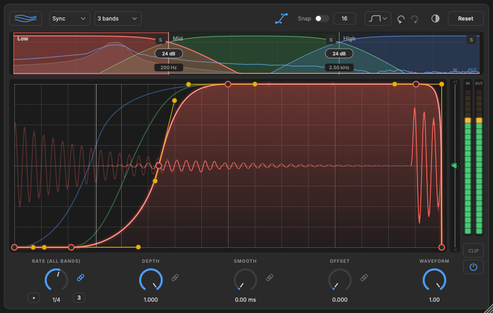
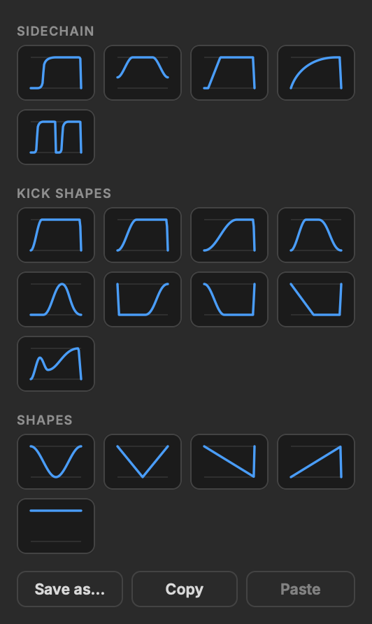

# Free LFO Tool

A free VST3 volume-shaper effect: draw a curve, and the plugin ducks your sound along it, locked to the tempo of your DAW. It is made for sidechain-style pumping, gating, tremolo and rhythmic volume patterns, and it has a **multiband mode** that gives the lows, mids and highs their own curves.

It is an independent, from-scratch implementation inspired by the workflow of Xfer Records' LFOTool and the volume shaper in Cableguys' ShaperBox. It contains no code from either.


> The screenshots in this README are rendered offline by the project's own test tool, with synthetic audio, so colours differ a little from a real window.

## Contents

- [Features](#features)
- [Install](#install)
- [Using it](#using-it)
- [How it sounds: the design rules](#how-it-sounds-the-design-rules)
- [Performance](#performance)
- [Testing](#testing)
- [Building from source](#building-from-source)
- [Project layout](#project-layout)
- [Known limitations and roadmap](#known-limitations-and-roadmap)
- [License and credits](#license-and-credits)

## Features

**Curve editor**
- Draw any shape: double-click to add points, drag to move them.
- **Bezier handles** on every point, After Effects style: all handles are visible at once, smooth by default, with Shift to break them apart.
- **Simple mode**: one draggable diamond per segment instead of handles. It reaches much sharper bends than the handles can, and switching between the two styles converts your curve so it stays editable.
- Delete a point with a double-click (the first and last points stay), straighten a Simple-mode segment by double-clicking its diamond, toggle easy-ease by double-clicking the first or last point.
- **Grid and snapping**: snapping is off by default; hold **Option (macOS) / Alt (Windows)** to snap, or turn the **Snap** switch on to reverse that. A draggable number sets how many grid lines there are (2, 3, 4, 6, 8, 12, 16, 24, 32, 36, 48, 64) and snapping lands exactly on the drawn lines.
- **Undo / redo** for every edit (Ctrl/Cmd+Z, Shift+Ctrl/Cmd+Z or Ctrl+Y, or the arrows in the header): one step per drag, includes reset and the Bezier switch, and keeps the last 50 steps (about 40 KB).
- **Presets and copy/paste** from the header's curve button: 20 factory shapes (house pump, soft and hard duck, long release, pump x2, nine kick-style rise/hold/drop shapes, sine, triangle, saws, flat) shown as small curve thumbnails, **Save curve as preset...** for your own, **Copy curve** and **Paste curve** (works between plugin instances and projects). A preset or pasted curve replaces only the curve you are editing (the selected band in Multiband) and is undoable.
- Click empty space to hide every point and handle and see the bare curve; click the curve to bring them back.
- The first and last points always share one height, so the loop has no click where it wraps around.

**Timing**
- **Sync** to the host tempo and song position with note values from 8 bars to 1/64, plus **dotted** and **triplet** buttons. The LFO position depends only on the song position, so it stays locked through jumps, loops and tempo changes.
- **Hz** mode: a free-running rate from 0.01 to 40 Hz, optionally restarted by MIDI notes.
- **Offset** shifts the LFO within its cycle, **Smooth** (0 to 200 ms) rounds off hard edges, **Depth** sets how deep the ducking goes.

**Multiband**
- Split into **low / mid / high** (or just low / high) with draggable split lines on a frequency strip. A **live spectrum** of the input runs behind the band curves, so you can see where to split. With two bands the split goes up to 12 kHz; with three, the low split tops out at 1 kHz.
- Each split has its own crossover slope: **6, 12, 24, 48, 72 or 96 dB/octave** (Linkwitz-Riley, so the bands add back to a flat response).
- Every band has its **own curve**, its own **rate** (or link them all), its own depth, smoothing and phase offset, and a **solo** button; solo several bands at once. A small chain beside the Depth, Smooth and Offset knobs links that control, so every band follows one value.
- The strip draws each band's real filter response, so you can see how the bands overlap at each slope.
- Defaults are a house-style sidechain pump where the lows stay ducked longest and the highs recover fastest.

**Feedback while you work**
- The input waveform is drawn folded onto the LFO cycle, faintly, with the **output** (what the plugin actually lets through) drawn over it in the curve's colour, so you can see where the kick and the hats land against your curve and what the ducking does to them. In the Single tab the output is coloured like a rainbow by pitch (red up to 100 Hz, then orange, yellow, green, turquoise and blue for the highs; a mix of lots of bass and highs tints pink or purple), a rough zero-crossing estimate; the input stays grey. In Multiband each band shows its own signal in its own colour (red lows, green mids, blue highs). The **Waveform** knob sets how strong this is.
- An optional sidechain input is drawn too (display only, see [limitations](#known-limitations-and-roadmap)).
- A thin **end-of-cycle meter** beside the curve shows where the input signal (-1 to +1, same scale as the scope) was at the last point of the cycle, right when the curve drops: the big arrow pointing at the curve is the newest cycle, the small ones the cycles before. An arrow near the centre line is safe (green); one far from it turns amber, then red, and means a bass note is still swinging when the gain falls, which is where clicks come from. Ease the fall, add a little Smooth, or leave some level at the end of the curve. In Multiband the meter follows the selected band.
- A grey line shows the **actual gain** after Depth, Smooth and Offset; the output waveform is the input multiplied by exactly that gain.
- Light and dark themes (dark is the default, the choice is remembered).
- **Resizable window** (880x500 up to 2000x1300): drag the bottom-right corner; the size is remembered.






## Install

**Windows (VST3)**
1. Open the repository's **Actions** tab, open the latest successful run, and download the `FreeLfoTool-windows-vst3` artifact.
2. Copy `Free LFO Tool.vst3` to `C:\Program Files\Common Files\VST3\`.
3. Rescan plugins in your DAW.

**macOS (VST3 and standalone app)**: build from source (see below) and copy `Free LFO Tool.vst3` to `~/Library/Audio/Plug-Ins/VST3/`. The build is not code-signed, so macOS may ask you to allow it.

Only the VST3 format is built (plus a standalone app for development). AU, AAX and CLAP are not available yet.

## Using it

| Do this | To get this |
|---|---|
| Double-click a knob, or right-click it | Type an exact value (rates accept `1/8`, `8`, `1 bar`...). Right-click also offers Reset to default; Cmd/Ctrl-click resets too |
| Double-click empty space | Add a point (new points start smooth, with their handles spread out) |
| Drag a point | Move it (the first and last points move together vertically) |
| Drag a handle | Bend the curve; the opposite handle follows on smooth points |
| Shift while dragging a handle | Break the handles apart |
| Option/Alt or Ctrl while dragging a handle | Snap the handle's tip to the grid |
| Double-click a point | Delete it (the first and last points stay) |
| Double-click the first or last point | Toggle easy-ease (flat tangents) |
| Hold Option/Alt while dragging or adding | Snap to the grid (reversed if the Snap switch is on) |
| Click empty space / click the curve | Hide / show all points and handles |
| **Bezier handles** switch | Flip between handle editing and one-diamond Simple mode (curves are converted) |
| Drag a diamond (Simple mode) | Bend that segment through the point; double-click to straighten |
| Drag the number next to **Snap** | Change the number of grid lines |
| Half-moon button | Light / dark theme |
| **Reset** | Restore the current curve to its default |

**Rate knob.** In Sync mode it steps through the straight note values from slow to fast; the **•** (dotted) and **3** (triplet) buttons next to it modify the value. In Hz mode it is a continuous frequency.

**Multiband tab.** Click a coloured region on the strip to edit that band, drag a split line to move it, click the pill on a split line to pick its slope, and use the **S** chips to solo bands. The knobs below belong to the selected band. The chain beside each of Rate, Depth, Smooth and Offset links that control: every band then follows one value (the mid band's, or the low band's in 2-band mode), and turning a link on copies the value you were looking at.

## How it sounds: the design rules

These are the promises the plugin is built to keep, and the test suite checks each of them.

- **It can only turn things down.** The gain is `1 - depth x (1 - curve)`, always between 0 and 1.
- **100% is a perfect null.** With a curve at 100% or with Depth at 0, the output is bit-for-bit identical to the input, including after you change settings and they settle.
- **0% is silence.** A curve at 0 gives exactly zero output, not a faint residue.
- **No clicks.** Anything that makes the LFO value jump (new rate, mode, offset, depth, a transport jump or a MIDI restart) glides over a few milliseconds, even with Smooth at 0. Solo and band changes fade. Moving a split frequency glides. Switching the tab, the band count or a slope dips the output for about 8 ms instead of clicking.
- **The result does not depend on the host's block size.** One block of 8192 samples and 1-sample blocks give the same audio.
- **Multiband is transparent.** With flat curves the bands add back to the input's level to within 0.001 dB; only the phase is shifted, as with any crossover.
- **It cannot blow up.** The crossover is stable at every slope, split and sample rate (22 to 192 kHz), NaN and infinity in the input are removed before they reach the filters, and an unstable filter is detected and restarted.
- **Real-time safe.** No memory is allocated on the audio thread, the curve editor hands curves to the audio thread without locks, and flush-to-zero keeps denormals from costing CPU.

### Under the hood

- **Curve model**: cubic Bezier segments between points (plus an optional exponential bend per segment for Simple mode). The curve is baked into a 2048-entry table whenever you edit it; the audio thread picks up a finished table with a try-lock and never waits.
- **Timing**: in Sync mode the LFO phase is computed from the host's song position, so it is sample-accurate and survives any relocation. In Hz mode (or when the transport is stopped) a phase accumulator runs freely.
- **Crossover**: Linkwitz-Riley filters built from cascaded Butterworth biquads in double precision (a first-order pair for 6 dB). In three-band mode the low band also passes through an allpass copy of the upper split, which keeps the sum flat. The two splits can have different slopes.
- **Smoothing**: a one-pole smoother that is guaranteed to land exactly on its target (a plain one-pole stalls a few units short, which would break the null).
- **UI**: the grid, curve and handles are drawn once into cached images; each frame only blits those and draws the playhead and waveform. Redraws are tied to the display refresh, capped at about 60 fps, and skipped when nothing is moving.

## Performance

Share of **one CPU core**, measured by the offline test suite on an Apple Silicon Mac (lower is better; stereo, Release build):

| Mode | 44.1 kHz | 48 kHz | 96 kHz | 192 kHz |
|---|---|---|---|---|
| Single band, editor closed | 0.03% | 0.03% | 0.06% | 0.12% |
| Single band, editor open | 0.06% | 0.06% | 0.12% | 0.23% |
| Multiband 24 dB/oct, editor closed | 0.16% | 0.18% | 0.37% | 0.71% |
| Multiband 96 dB/oct (heaviest), editor closed | 0.46% | 0.50% | 1.00% | 2.01% |

(512-sample blocks; 32-sample blocks cost up to about 30% more.) The editor only costs anything while it is open. These figures are from one machine and will differ on yours, but the ratios hold: single band is almost free, and the heaviest multiband setting at 192 kHz is still around 2% of a core.

## Testing

Everything below runs offline, without a DAW or a sound card. A small **fake DAW** feeds the real plugin code with a transport at **130 bpm** and renders audio through it.

| Program | What it checks | How to run |
|---|---|---|
| `LfoAudioTest` | **117 audio checks**: bit-exact null at 100%, exact silence at 0%, transparency of every crossover slope, block-size independence, clicks on 24 kinds of parameter change, filter stability across 4 sample rates, NaN/Inf and zero-length blocks, a fuzz test that randomises every parameter and the transport, tempo accuracy at 130 bpm, Hz accuracy, MIDI restart, the sidechain bus, state save/load, zero allocations on the audio thread, thread safety while the curve is edited, CPU worst cases and denormals | `build/LfoAudioTest_artefacts/Release/LfoAudioTest` |
| `tests/envelope_test.cpp` | The curve model: Bezier evaluation, Simple-mode bends, conversions between the two, the default curves, saving and loading | `clang++ -std=c++17 tests/envelope_test.cpp -o envtest && ./envtest` |
| `tests/crossover_test.cpp` | The crossover maths for all six slopes, mixed slopes, and the drawn response curves | `clang++ -std=c++17 tests/crossover_test.cpp -o xotest && ./xotest` |
| `LfoBench` | CPU per block, plus quick null and multiband sanity checks | `build/LfoBench_artefacts/Release/LfoBench` |
| `LfoSnap` | Renders the editor to PNG files without a screen and drives it with synthetic mouse events: editing, snapping, handles, hiding, themes, header layout | `build/LfoSnap_artefacts/Release/LfoSnap <output-folder>` |

The three programs that need JUCE are built with `-DFREELFO_BENCH=ON` (see below). GitHub Actions builds the Windows and macOS plugins and runs `LfoAudioTest` on both for every push; timing limits are relaxed there because shared machines are noisy.

## Building from source

You need CMake 3.22 or newer, a C++17 compiler (Xcode command line tools, or Visual Studio with the C++ workload) and an internet connection: JUCE 8 is downloaded by CMake the first time.

```bash
# plugin (VST3) and standalone app
cmake -B build -DCMAKE_BUILD_TYPE=Release
cmake --build build --config Release --parallel

# the same, plus the test programs
cmake -B build -DCMAKE_BUILD_TYPE=Release -DFREELFO_BENCH=ON
cmake --build build --config Release --parallel
build/LfoAudioTest_artefacts/Release/LfoAudioTest
```

On Windows, pass `-A x64` to the configure step and use the `.exe` paths. Build outputs land in `build/FreeLfoTool_artefacts/Release/`.

## Project layout

```
Source/
  PluginProcessor.*     audio engine: single band, multiband, smoothing, declick, state
  Envelope.h            the curve model (no JUCE; unit-testable)
  Crossover.h           the Linkwitz-Riley band splitter (no JUCE; unit-testable)
  Spectrum.h            FFT + dB conversion for the live spectrum (no JUCE)
  PluginEditor.*        the window: header, tabs, knobs
  EnvelopeEditor.*      the curve editor (points, handles, snapping, drawing)
  MultibandPanel.*      the frequency strip and the multiband tab
  PaperLookAndFeel.h    the light and dark themes and the custom controls
  Fonts.h               the bundled Inter font
Assets/Fonts/           Inter Regular and SemiBold, plus its license
tests/                  the test programs above and the shared fake DAW
docs/images/            screenshots used in this README
.github/workflows/      CI: builds and tests on Windows and macOS
```

## Known limitations and roadmap

- **Not hardware-tested yet.** It has been developed on macOS and tested offline against a simulated host. Windows builds come from CI; hands-on testing in real DAWs (starting with FL Studio) is still to do.
- **The sidechain input is display-only.** It lets you see a kick against your curve, but it does not trigger the LFO yet. Use the host tempo, or MIDI in Hz mode.
- **Structural switches dip the audio** for about 8 ms (the tab, the band count and the crossover slopes). It is click-free but not seamless; change them when the plugin is not playing a critical passage.
- **Not built yet:** a full preset browser (folders, rename), copy/paste of whole multiband setups, audio or envelope triggering, other formats (AU, AAX, CLAP).

## License and credits

Free LFO Tool is open source under the [GNU Affero General Public License v3](LICENSE) (AGPL-3.0), the same license JUCE 8 is offered under. You can use, study, modify and share it, and if you distribute a modified version you must share its source under the same license.

VST is a trademark of Steinberg Media Technologies GmbH. The VST3 SDK is used through JUCE. LFOTool and ShaperBox are products of their respective owners, mentioned only as inspiration.

The interface font is [Inter](https://rsms.me/inter/) by Rasmus Andersson, bundled under the SIL Open Font License 1.1 (`Assets/Fonts/Inter-LICENSE.txt`).
