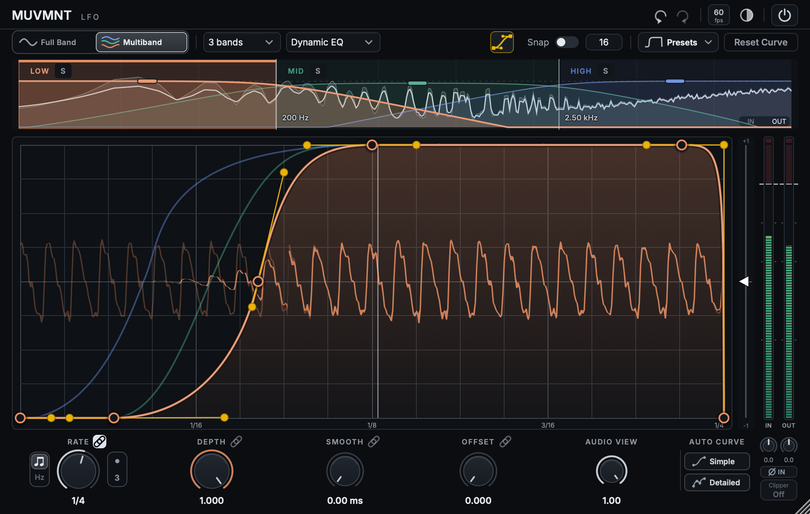
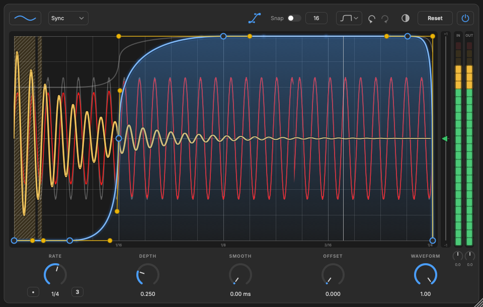

# Free LFO Tool

A free VST3 volume-shaper effect: draw a curve, and the plugin ducks your sound along it, locked to the tempo of your DAW. It is made for sidechain-style pumping, gating, tremolo and rhythmic volume patterns, and it has a **multiband mode** that gives the lows, mids and highs their own curves.

It is an independent, from-scratch implementation inspired by the workflow of Xfer Records' LFOTool and the volume shaper in Cableguys' ShaperBox. It contains no code from either.


> The screenshots in this README are rendered offline by the project's own test tool, with synthetic audio, so colours differ a little from a real window.

## Contents

- [Features](#features)
- [Install](#install)
- [Using it](#using-it)
- [For producers: the trade-offs](#for-producers-the-trade-offs)
- [How it sounds: the design rules](#how-it-sounds-the-design-rules)
- [Performance](#performance)
- [Testing](#testing)
- [Building from source](#building-from-source)
- [Project layout](#project-layout)
- [Known limitations and roadmap](#known-limitations-and-roadmap)
- [License and credits](#license-and-credits)

## Features

**Curve editor**
- Draw any shape: double-click to add points, drag to move them.
- **Bezier handles** on every point, After Effects style: all handles are visible at once, smooth by default, with Shift to break them apart.
- **Simple mode**: one draggable diamond per segment instead of handles. It reaches much sharper bends than the handles can, and switching between the two styles converts your curve so it stays editable.
- Delete a point with a double-click (the first and last points stay), straighten a Simple-mode segment by double-clicking its diamond, toggle easy-ease by double-clicking the first or last point.
- **Grid and snapping**: snapping is off by default; hold **Option (macOS) / Alt (Windows)** to snap, or turn the **Snap** switch on to reverse that. A draggable number sets how many grid lines there are (2, 3, 4, 6, 8, 12, 16, 24, 32, 36, 48, 64) and snapping lands exactly on the drawn lines.
- Up to **64 points per curve**. At the limit, double-clicking shows a short note instead of adding a point. Pasted curves and preset files with more are refused whole, never cut short, and switching to Simple mode never splits a curve past the limit. A project saved with more points (up to 512) loads unchanged.
- In Sync mode, **very small note values under the graph** mark the quarters of the cycle (at a 1/4 rate: 1/16, 1/8, 3/16, 1/4; dotted and triplet rates add D or T), so you can find the middle at a glance. They are hidden in Hz mode.
- **Undo / redo** for every edit (Ctrl/Cmd+Z, Shift+Ctrl/Cmd+Z or Ctrl+Y, or the arrows in the header): one step per drag, includes reset and the Bezier switch, and keeps the last 50 steps (about 40 KB).
- **Presets and copy/paste** from the header's curve button: 20 factory shapes (house pump, soft and hard duck, long release, pump x2, nine kick-style rise/hold/drop shapes, sine, triangle, saws, flat) shown as small curve thumbnails, **Save curve as preset...** for your own, **Copy curve** and **Paste curve** (works between plugin instances and projects). A preset or pasted curve replaces only the curve you are editing (the selected band in Multiband) and is undoable.
- Click empty space to hide every point and handle and see the bare curve; click the curve to bring them back.
- The first and last points always share one height, so the loop has no click where it wraps around.

**Timing**
- **Sync** to the host tempo and song position with note values from 8 bars to 1/64, plus **dotted** and **triplet** buttons. The LFO position depends only on the song position, so it stays locked through jumps, loops and tempo changes.
- **Hz** mode: a free-running rate from 0.01 to 40 Hz, optionally restarted by MIDI notes.
- **Offset** shifts the LFO within its cycle, **Smooth** (0 to 200 ms) rounds off hard edges, **Depth** sets how deep the ducking goes.

**Multiband**
- Split into **low / mid / high** (or just low / high) with draggable split lines on a frequency strip. A **live spectrum** runs behind the band curves, so you can see where to split: the input as a grey fill, and the output (after the ducking) as a bright blue line, so you can see what the LFO does to your balance. With two bands the split goes up to 12 kHz; with three, the low split tops out at 1 kHz.
- Two **multiband types**, chosen in the header: **Crossover** (the default) splits the audio into bands and adds them back together, with steep, selectable slopes. **Dynamic EQ** leaves the audio unsplit and turns ranges down with moving shelves: zero latency, and while the curves are open the output is the input bit for bit, so there is no phase shift to soften transients. Phase only shifts while the bands are at different levels. The trade-off is a fixed, gentle slope (about 12 dB/octave), so ducking one band reaches further into its neighbours, and with three bands and splits close together the mid band gets less deep and less distinct.
- In Crossover, each split has its own slope: **6, 12, 24, 48, 72 or 96 dB/octave** (Linkwitz-Riley, so the bands add back to a flat response).
- Every band has its **own curve**, its own **rate** (or link them all), its own depth, smoothing and phase offset, and a **solo** button; solo several bands at once. A small chain beside the Depth, Smooth and Offset knobs links that control, so every band follows one value.
- The strip draws each band's real filter response, so you can see how the bands overlap at each slope.
- Defaults are a house-style sidechain pump where the lows stay ducked longest and the highs recover fastest.

**Feedback while you work**
- The input waveform is drawn folded onto the LFO cycle, faintly, with the **output** (what the plugin actually lets through) drawn over it in the curve's colour, so you can see where the kick and the hats land against your curve and what the ducking does to them. In the Single tab the output is coloured like a rainbow by pitch (red up to 100 Hz, then orange, yellow, green, turquoise and blue for the highs; a mix of lots of bass and highs tints pink or purple), a rough zero-crossing estimate; the input stays grey. In Multiband each band shows its own signal in its own colour (red lows, green mids, blue highs). The **Waveform** knob sets how strong this is.
- An optional sidechain input is drawn in amber: route a kick from another mixer channel into the plugin's sidechain and you see it against your curve (display only, it never changes the sound). Where the kick and the plugin's output are both loud at the same position in the cycle, that stretch is **hatched**: a conflict between the two. The output is measured after the ducking, so a spot where your curve really ducks under the kick is not marked. In Multiband the kick is split into the same bands, so each band is compared with the matching part of the kick (the lows against the kick's lows).
- A thin **end-of-cycle meter** beside the curve shows where the output signal (the input after the plugin's ducking, -1 to +1, same scale as the scope) was at the last point of the cycle, right when the curve drops: the big arrow pointing at the curve is the newest cycle, the small ones the cycles before. An arrow near the centre line is safe (green); one far from it turns amber, then red, and means a bass note is still swinging when the gain falls, which is where clicks come from. Duck harder at the end of the curve, ease the fall, or add a little Smooth, and watch the arrow settle at the middle. Click the meter to show an **end-zone bar** next to the arrow (hidden by default, and remembered with the project): a thin bar that spans the lowest to the highest output level over the last 4% of the cycle (it grows at once and falls back slowly, and the arrow glides to each new value), to catch heavy ducking that happens just before the end: a long red bar means the signal is still loud while the gain drops, even if the arrow itself sits at the middle. In Multiband the meter follows the selected band.
- **IN / OUT meters** on the right are analog-style stacks of squares (mostly green, then yellow, with one red square at the top that lights at about 0 dBFS), with a soft glow on the lit squares. They show the peak level going in and coming out. They are built for loud material: 26 squares, 1.5 dB apart in the top third, a fast fall (80 dB/s) and a red square that follows the signal like the rest, so they keep moving on a loud, pumping mix.
- Two small **input and output gain** knobs sit right under the meters (-24 to +24 dB, 0 dB pointing up, with the value written under each; double-click, Ctrl-click (Cmd on macOS) or Alt/Option-click returns them there). Input gain comes before everything else, so the meters and displays show the adjusted signal. Output gain comes before the clipper.
- In the multiband view, a **CLIP** button under the gain knobs (off by default) cycles an output clipper: Off, Soft (linear up to -2 dB, then a smooth shoulder) or Hard (flat at 0 dB). Re-summing the bands can push the output past the input's peaks, and this keeps it from going over 0 dB.
- A **bypass** button (power icon) in the top right corner, beside Reset, passes the audio through untouched, with a 10 ms crossfade so it never clicks, and no CPU use while it is bypassed. It is also the host's bypass: the host's own bypass button drives the same switch.
- A grey line shows the **actual gain** after Depth, Smooth and Offset; the output waveform is the input multiplied by exactly that gain.
- Light and dark themes (dark is the default, the choice is remembered).
- **Resizable window** (880x500 up to 2000x1300): drag the bottom-right corner; the size is remembered.







## Install

**Windows (VST3)**
1. Open the repository's **Actions** tab, open the latest successful run, and download the `FreeLfoTool-windows-vst3` artifact.
2. Copy `Free LFO Tool.vst3` to `C:\Program Files\Common Files\VST3\`.
3. Rescan plugins in your DAW.

**macOS (VST3 and standalone app)**: build from source (see below) and copy `Free LFO Tool.vst3` to `~/Library/Audio/Plug-Ins/VST3/`. The build is not code-signed, so macOS may ask you to allow it.

Only the VST3 format is built (plus a standalone app for development). AU, AAX and CLAP are not available yet.

## Using it

| Do this | To get this |
|---|---|
| Double-click a knob, or right-click it | Type an exact value (rates accept `1/8`, `8`, `1 bar`...). Right-click also offers Reset to default, followed by your DAW's own options for that parameter (such as automation) if it provides them to VST3 plugins; Cmd/Ctrl-click resets too |
| Double-click empty space | Add a point (new points start smooth, with their handles spread out) |
| Drag a point | Move it (the first and last points move together vertically) |
| Drag a handle | Bend the curve; the opposite handle follows on smooth points |
| Shift while dragging a handle | Break the handles apart |
| Option/Alt or Ctrl while dragging a handle | Snap the handle's tip to the grid |
| Double-click a point | Delete it (the first and last points stay) |
| Double-click the first or last point | Toggle easy-ease (flat tangents) |
| Hold Option/Alt while dragging or adding | Snap to the grid (reversed if the Snap switch is on) |
| Click empty space / click the curve | Hide / show all points and handles |
| **Bezier handles** switch | Flip between handle editing and one-diamond Simple mode (curves are converted) |
| Drag a diamond (Simple mode) | Bend that segment through the point; double-click to straighten |
| Drag the number next to **Snap** | Change the number of grid lines |
| Wave icon (top left) | Switch between **Single** (one wave) and **Multiband** (three stacked waves); the icon shows the current mode |
| Small knobs under the meters | Input / output gain (right-click for reset and your DAW's options); double-click, Ctrl-click (Cmd on macOS) or Alt/Option-click resets to 0 dB |
| Ctrl-click (Cmd on macOS) or Alt-click a knob | Reset it to its default |
| CLIP button (multiband, under the gain knobs) | Cycle the output clipper: Off / Soft / Hard |
| Power button (top right) | Bypass |
| Click the end-of-cycle meter | Show or hide the end-zone bar |
| Half-moon button | Light / dark theme |
| **Reset** | Restore the current curve to its default |

**Rate knob.** In Sync mode it steps through the straight note values from slow to fast; the **•** (dotted) and **3** (triplet) buttons next to it modify the value. In Hz mode it is a continuous frequency.

**Multiband tab.** Click a coloured region on the strip to edit that band, drag a split line to move it, click the pill on a split line to pick its slope (Crossover only), and use the **S** chips to solo bands. The knobs below belong to the selected band. The chain beside each of Rate, Depth, Smooth and Offset links that control: every band then follows one value (the mid band's, or the low band's in 2-band mode), and turning a link on copies the value you were looking at.

## For producers: the trade-offs

**Short version:** use **Single** unless you need different ducking for the lows, mids and highs. Multiband gives you more control, but it uses filters, and filters have side effects.

### Single band

Single band is only a volume knob that follows your curve. It has no filters and adds no latency or phase shift. Where the curve is at 100%, your audio passes through bit for bit (with the IN and OUT gain knobs at 0 dB).

What to watch comes from the curve itself, as with any volume shaper:

- **Clicks.** A very fast drop or rise can click, especially on bass and 808s, if it cuts the wave in the middle of a swing. Make the edge a little less steep or add some **Smooth**. The end-of-cycle meter helps you check the point where the curve wraps around.
- **Too much Smooth** rounds off your shape and makes it react later, so the pump can feel less tight and the duck may arrive late for the kick. Use only as much as you need.
- **Very fast, deep movement** (fast Hz rates, hard gates) changes the tone as well as the volume. That can be the effect you want.
- **It ducks everything together.** Hats and vocals in the same audio dip along with the bass. If that is a problem, try Multiband.

These also apply to each band in Multiband.

### Multiband: Crossover (default)

**Good for:** the clearest separation between bands, for example ducking the lows hard while leaving the highs almost untouched.

- **It changes the wave even when the curves are flat.** The volume of each frequency stays the same, but frequencies near a split are shifted in time (phase shift). The plugin reports no latency, because the shift differs from frequency to frequency and your DAW can't compensate for it.
- **Drums can feel a bit softer**, snares for example. It is often subtle. Compare with the bypass button, which skips the filters. Setting Depth to 0 does not.
- **Peaks can get higher**, even while nothing is being ducked. In a test with a clipped 55 Hz bass and flat curves, peaks rose by about 4 to 6.5 dB (6 dB slope: no rise). Watch the OUT meter. Lower the OUT knob, or use **CLIP**, which stops peaks at 0 dB but adds distortion when it works.
- **Be careful with parallel processing.** If you blend the output with an unprocessed copy of the same sound, some frequencies can partly or almost completely cancel (every slope except 6 dB). This includes layering it with a dry duplicate or using a wet/dry mix outside the plugin. Use the plugin's **Depth** control instead if you want less effect.

**Choosing a slope:** steeper slopes keep the bands more separate, but shift more and use more CPU. With a split at 150 Hz, the delay around the split is roughly 3 ms at 24 dB, up to about 8 ms at 48 dB and up to about 19 ms at 96 dB. At a 2.5 kHz split with 24 dB it is only about 0.2 ms. **24 dB is a good starting point.** The 6 dB slope has no phase shift with flat curves, but its bands overlap a lot.

### Multiband: Dynamic EQ

**Good for:** keeping your sound as close to the original as possible, especially full mixes and drums. It works like an EQ that moves with your curves.

- **Flat curves leave the audio untouched**, bit for bit (with the gain knobs at 0 dB). It adds no latency.
- **It still shifts phase while ducking**, like a normal EQ, when the bands are at different levels. When all bands are at the same level, it is a plain volume change.
- **The bands are less separate.** The slope is fixed and gentle, so ducking one band also affects its neighbours more.
- **It doesn't duck as deeply.** Example: with a 200 Hz split and the low band fully ducked, a 60 Hz tone drops by about 21 dB in Dynamic EQ and about 42 dB in Crossover at 24 dB. At 100 Hz it is about 12 dB and 25 dB. If you need the low end almost gone, use Crossover or move the split higher (which also affects more of the sound above it).
- **Keep three-band splits far apart.** If they are close together, the mid band has a weaker, less focused effect.

### Which one should I use?

| You want | Try |
|---|---|
| Classic sidechain pumping on one sound | Single |
| Hard, clean ducking of only the lows | Multiband, Crossover |
| Gentle movement on a full mix, keeping drums close to the original | Multiband, Dynamic EQ |
| Blending with a dry copy outside the plugin | Single |

Trust your ears: match the volume and compare with bypass while the whole track is playing.

## How it sounds: the design rules

These are the promises the plugin is built to keep, and the test suite checks each of them.

- **The LFO can only turn things down.** Its gain is `1 - depth x (1 - curve)`, always between 0 and 1. Only the input and output gain knobs can add level, and at 0 dB they don't touch the audio.
- **100% is a perfect null.** With a curve at 100% or with Depth at 0, the output is bit-for-bit identical to the input, including after you change settings and they settle.
- **0% is silence.** A curve at 0 gives exactly zero output, not a faint residue.
- **No clicks.** Anything that makes the LFO value jump (new rate, mode, offset, depth, a transport jump or a MIDI restart) glides over a few milliseconds, even with Smooth at 0. Solo and band changes fade. Moving a split frequency glides. Switching the tab, the multiband type, the band count or a slope dips the output for about 8 ms instead of clicking.
- **The result does not depend on the host's block size.** One block of 8192 samples and 1-sample blocks give the same audio.
- **Multiband is transparent.** With flat curves, Crossover adds the bands back to the input's level to within 0.001 dB; only the phase is shifted, as with any crossover (the 6 dB slope shifts none). Dynamic EQ with flat curves is bit-for-bit identical to the input.
- **It cannot blow up.** The crossover is stable at every slope, split and sample rate (22 to 192 kHz), NaN and infinity in the input are removed before they reach the filters (and are never accepted from typed values, settings, curves, projects or the host's tempo), and an unstable filter is detected and restarted.
- **Real-time safe.** No memory is allocated on the audio thread, the curve editor hands curves to the audio thread without locks, and flush-to-zero keeps denormals from costing CPU.

### Under the hood

- **Curve model**: cubic Bezier segments between points (plus an optional exponential bend per segment for Simple mode). The curve is baked into a 2048-entry table whenever you edit it; the audio thread picks up a finished table with a try-lock and never waits.
- **Timing**: in Sync mode the LFO phase is computed from the host's song position, so it is sample-accurate and survives any relocation. In Hz mode (or when the transport is stopped) a phase accumulator runs freely.
- **Crossover**: Linkwitz-Riley filters built from cascaded Butterworth biquads in double precision (a first-order pair for 6 dB). In three-band mode the low band also passes through an allpass copy of the upper split, which keeps the sum flat. The two splits can have different slopes.
- **Dynamic EQ**: one 2nd-order state-variable filter per split. The filters depend only on the split frequencies; the band gains only change how their outputs are mixed with the input (the geometric mean of two neighbouring gains weights the middle term). So the gains can move every sample, all the way to 0, with nothing to destabilise, equal gains are a plain volume change, and in the tests no combination of gains boosts a tone by more than 0.01 dB.
- **Smoothing**: a one-pole smoother that is guaranteed to land exactly on its target (a plain one-pole stalls a few units short, which would break the null).
- **UI**: the grid, curve and handles are drawn once into cached images; each frame only blits those and draws the playhead and waveform. Redraws are tied to the display refresh, capped at about 60 fps, and skipped when nothing is moving.

## Performance

Share of **one CPU core**, measured by the offline test suite on an Apple Silicon Mac (lower is better; stereo, Release build):

| Mode | 44.1 kHz | 48 kHz | 96 kHz | 192 kHz |
|---|---|---|---|---|
| Single band, editor closed | 0.03% | 0.03% | 0.06% | 0.12% |
| Single band, editor open | 0.07% | 0.08% | 0.16% | 0.32% |
| Multiband 24 dB/oct, editor closed | 0.17% | 0.18% | 0.37% | 0.73% |
| Multiband 96 dB/oct (heaviest), editor closed | 0.49% | 0.51% | 1.02% | 2.02% |
| Multiband 96 dB/oct, editor open | 0.51% | 0.55% | 1.10% | 2.15% |
| Multiband Dynamic EQ, editor closed | 0.08% | 0.09% | 0.17% | 0.35% |
| Multiband Dynamic EQ, editor open | 0.14% | 0.14% | 0.28% | 0.53% |
| Bypassed | ~0% | ~0% | ~0% | ~0% |

(512-sample blocks; 32-sample blocks cost up to about 30% more.) The editor only costs anything while it is open (the waveform, spectrum and meters are only analysed then), and a bypassed plugin does nothing at all. These figures are from one machine and will differ on yours, but the ratios hold: single band is almost free, and the heaviest multiband setting at 192 kHz is still around 2% of a core.

## Testing

Everything below runs offline, without a DAW or a sound card. A small **fake DAW** feeds the real plugin code with a transport at **130 bpm** and renders audio through it.

| Program | What it checks | How to run |
|---|---|---|
| `LfoAudioTest` | **186 audio checks**: bit-exact null at 100%, exact silence at 0%, transparency of every crossover slope, the Dynamic EQ (bit-exact when open, never boosting, band isolation), block-size independence, clicks on 30 kinds of parameter change, filter stability across 4 sample rates, NaN/Inf and zero-length blocks, a fuzz test that randomises every parameter and the transport, tempo accuracy at 130 bpm, Hz accuracy, MIDI restart, the sidechain bus, bypass (bit-exact, click-free, allocation-free), the output clipper, the input and output gain knobs, the peak meters and the spectrum analyser, state save/load (including projects over the point limit), settings, curves and projects containing NaN or infinity, zero allocations on the audio thread, thread safety while the curve is edited, CPU worst cases and denormals | `build/LfoAudioTest_artefacts/Release/LfoAudioTest` |
| `tests/envelope_test.cpp` | The curve model: Bezier evaluation, Simple-mode bends, conversions between the two, the default curves, saving and loading, the 64-point limit | `clang++ -std=c++17 tests/envelope_test.cpp -o envtest && ./envtest` |
| `tests/crossover_test.cpp` | The crossover maths for all six slopes, mixed slopes, and the drawn response curves | `clang++ -std=c++17 tests/crossover_test.cpp -o xotest && ./xotest` |
| `LfoMonkey` | Random clicks, drags, resizing, closing and reopening the window, automation, undo, and normal and damaged project loads, while audio runs on a second thread. Checks that the audio and curves stay valid. Most useful built with sanitizers (`-fsanitize=address,undefined` or `-fsanitize=thread`) | `build/LfoMonkey_artefacts/Release/LfoMonkey [seed] [actions]` |
| `LfoBench` | CPU per block (including the bypassed and editor-open cases), plus quick null and multiband sanity checks | `build/LfoBench_artefacts/Release/LfoBench` |
| `LfoSnap` | Renders the editor to PNG files without a screen and drives it with synthetic mouse events: editing, snapping, handles, hiding, themes, header layout | `build/LfoSnap_artefacts/Release/LfoSnap <output-folder>` |

The four programs that need JUCE are built with `-DFREELFO_BENCH=ON` (see below). GitHub Actions builds the Windows and macOS plugins and runs `LfoAudioTest` on both for every push; timing limits are relaxed there because shared machines are noisy.

## Building from source

You need CMake 3.22 or newer, a C++17 compiler (Xcode command line tools, or Visual Studio with the C++ workload) and an internet connection: JUCE 8 is downloaded by CMake the first time.

```bash
# plugin (VST3) and standalone app
cmake -B build -DCMAKE_BUILD_TYPE=Release
cmake --build build --config Release --parallel

# the same, plus the test programs
cmake -B build -DCMAKE_BUILD_TYPE=Release -DFREELFO_BENCH=ON
cmake --build build --config Release --parallel
build/LfoAudioTest_artefacts/Release/LfoAudioTest
```

On Windows, pass `-A x64` to the configure step and use the `.exe` paths. Build outputs land in `build/FreeLfoTool_artefacts/Release/`.

## Project layout

```
Source/
  PluginProcessor.*     audio engine: single band, multiband, smoothing, declick, state
  Envelope.h            the curve model (no JUCE; unit-testable)
  Crossover.h           the Linkwitz-Riley band splitter (no JUCE; unit-testable)
  DynamicEq.h           the zero-latency Dynamic EQ multiband type (no JUCE)
  Spectrum.h            FFT analyser for the live spectrum (no JUCE; allocation-free)
  PluginEditor.*        the window: header, tabs, knobs
  EnvelopeEditor.*      the curve editor (points, handles, snapping, drawing)
  MultibandPanel.*      the frequency strip and the multiband tab
  LevelMeter.h          the IN / OUT peak meters (squares with a glow)
  PaperLookAndFeel.h    the light and dark themes and the custom controls (icon buttons, knobs, bypass)
  Fonts.h               the bundled Inter font
Assets/Fonts/           Inter Regular and SemiBold, plus its license
tests/                  the test programs above and the shared fake DAW
docs/images/            screenshots used in this README
.github/workflows/      CI: builds and tests on Windows and macOS
```

## Known limitations and roadmap

- **Tested mostly in FL Studio on Windows.** It is developed on macOS and checked offline against a simulated host; Windows builds come from CI and have been used in FL Studio. Other DAWs (Ableton, Logic, Reaper, Bitwig) and other operating systems have not been tried by hand yet.
- **The sidechain input is display-only.** It lets you see a kick against your curve and where it conflicts with your sound, but it does not trigger the LFO. Use the host tempo, or MIDI in Hz mode.
- **Structural switches dip the audio** for about 8 ms (the tab, the multiband type, the band count and the crossover slopes). It is click-free but not seamless; change them when the plugin is not playing a critical passage.
- **Bypass stops the LFO.** While bypassed nothing is processed, so the free-running phase (Hz mode) pauses; in Sync mode the LFO follows the host position and stays on the beat.
- **Not built yet:** a full preset browser (folders, rename), copy/paste of whole multiband setups, audio or envelope triggering, other formats (AU, AAX, CLAP).

## License and credits

Free LFO Tool is open source under the [GNU Affero General Public License v3](LICENSE) (AGPL-3.0), the same license JUCE 8 is offered under. You can use, study, modify and share it, and if you distribute a modified version you must share its source under the same license.

VST is a trademark of Steinberg Media Technologies GmbH. The VST3 SDK is used through JUCE. LFOTool and ShaperBox are products of their respective owners, mentioned only as inspiration.

The interface font is [Inter](https://rsms.me/inter/) by Rasmus Andersson, bundled under the SIL Open Font License 1.1 (`Assets/Fonts/Inter-LICENSE.txt`).
